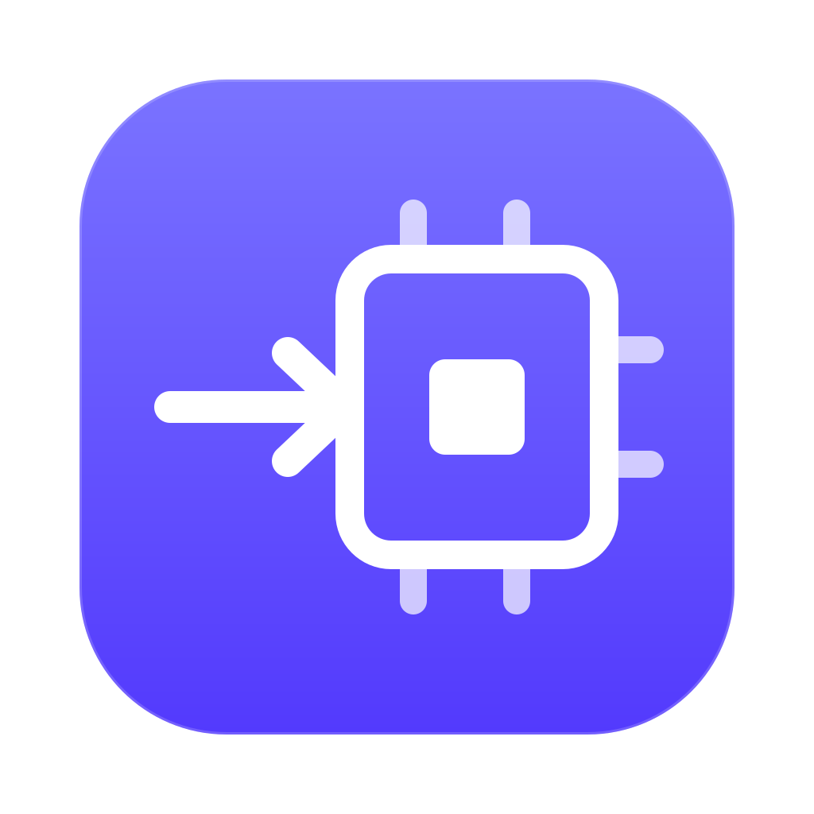

<p align="center">
  
</p>

<h1 align="center">Borrowed Compute</h1>

<p align="center">
  <b>Use your other computers as if they were this one.</b><br>
  Run code on any of your Macs and PCs, and run AI models across all of them at once.<br>
  No cloud, no VPN, no server to rent.
</p>

<p align="center">
  <a href="https://github.com/Harshil089/Borrowed-Compute-releases/releases/latest"></a>
  
  
  
</p>

<p align="center">
  <a href="https://github.com/Harshil089/Borrowed-Compute-releases/releases/latest/download/BorrowedComputeAgent.dmg"><b>Download for Mac</b></a>
  &nbsp;·&nbsp;
  <a href="https://github.com/Harshil089/Borrowed-Compute-releases/releases/latest/download/BorrowedCompute-setup.exe"><b>Download for Windows</b></a>
  &nbsp;·&nbsp;
  <a href="https://borrowed-compute.vercel.app">Website</a>
</p>

---

```
   This computer                                         Your other computer
  ┌──────────────────────┐   encrypted, direct      ┌──────────────────────────┐
  │  project folder      │ ───────────────────────▶ │  sandboxed job           │
  │  live output         │   (relay as fallback)    │  its own toolchains      │
  │  localhost:5173      │ ◀─────────────────────── │  its CPU, GPU and RAM    │
  └──────────────────────┘                          └──────────────────────────┘
```

Pick a project folder, type a command, and it runs on another of your computers: builds,
tests, scripts, dev servers. Output streams back live, and dev servers open in this
computer's browser at `localhost`. It works in any direction (Windows to Mac, Mac to
Windows, Mac to Mac, PC to PC), on any network, and nothing from your project stays on the
other computer once the job ends.

## Contents

- [Features](#features)
- [Get started](#get-started)
- [Run AI models across your devices](#run-ai-models-across-your-devices)
- [Share a computer with someone](#share-a-computer-with-someone)
- [Security](#security)
- [Command line](#command-line)
- [Develop](#develop)

## Features

| | |
|---|---|
| **Run any command** | `cargo test`, `npm run build`, `python train.py`, a shell script. The project is packed, sent, run in a fresh workspace and deleted after. Projects up to 20 GB. |
| **Live output and timings** | Connect, upload, first output and total time, direct or relay, plus what the job used: CPU time, cores, peak memory. |
| **Knows your project** | Recognizes Node, Python, Rust, Go, plain HTML and more, and suggests the right commands for the other computer's system. A `bc.toml` in the folder always wins. |
| **Fixes first-run failures** | `node_modules`, `.venv` and build output are not uploaded, so it installs and builds first when a command needs it. After a failure (a missing module, command or build file) it fixes the cause and runs once more. |
| **Servers that keep running** | Tick *Keep running* (it ticks itself for `dev`, `start` and `serve` scripts) and the server stays up, with the computer kept awake, until you press Stop. |
| **Port forwarding** | A server on the other computer's port 5173 opens at `http://localhost:5173` here, and reconnects quietly over flaky networks. |
| **AI models across devices** | One language model split over several of your computers, served at an OpenAI-compatible address. GPUs used automatically. [More below.](#run-ai-models-across-your-devices) |
| **One app, both roles** | The same app uses other computers and lends this one. Lending is one switch. |
| **Updates itself** | Moves to the latest signed release when it starts; dropped downloads are retried. |

## Get started

1. **Install the app** on each computer:
   [Mac](https://github.com/Harshil089/Borrowed-Compute-releases/releases/latest/download/BorrowedComputeAgent.dmg) ·
   [Windows](https://github.com/Harshil089/Borrowed-Compute-releases/releases/latest/download/BorrowedCompute-setup.exe).
   > The Mac app is not notarized yet: the first time, open **System Settings › Privacy & Security** and click **Open Anyway**. On Windows, SmartScreen may warn; choose **More info › Run anyway**.
2. **On your first computer**, sign in with GitHub or Google and choose **Keep the account on this computer**.
3. **On each other computer**, the app asks *Where does your account live?* Pick your first computer from the network list, or paste its code (shown under **Paired devices**), and sign in with the same account.
4. **Pair once.** Click **Pair** next to the computer you want to use. It shows a code; type that code into the request on the other computer.
5. **Run.** Choose a project folder, pick or type a command, and press **Run**.

Computers find each other by code alone. They connect directly when the network allows and
through a relay when it does not (a VPN, a strict Wi-Fi), end-to-end encrypted either way.

## Run AI models across your devices

The **Mesh** page (or `bc mesh`) runs one language model on several of your paired
computers at once, with no cloud. Each computer holds only its share of the model.

```
   coordinator ──tokens──▶ ┌─────────┐ ──hidden state──▶ ┌─────────┐ ──▶ ┌─────────┐
   (this computer)         │ layers  │                   │ layers  │     │ layers  │
        ▲                  │  0–9    │                   │ 10–25   │     │ 26–31   │
        └──── next token ──┤  GPU    │                   │  CPU    │     │  GPU    │
                           └─────────┘                   └─────────┘     └─────────┘
```

- **Your models, your hardware.** Llama and Qwen families in GGUF, from Qwen2.5 0.5B up to
  405B-class models split across files, run by Borrowed Compute's own engine.
- **GPUs first.** Metal on a Mac, CUDA on an NVIDIA card, used automatically and checked
  against the CPU at startup. A card takes the layers that fit; RAM takes the rest.
- **Exact.** Data between devices crosses as exact values, so a split model writes exactly
  what the whole model writes.
- **Weights in memory only.** Each computer downloads only its own layers, straight into
  RAM, never to disk, and drops them two minutes after the model stops.
- **Balanced live.** The planner measures every device and link, puts layers where they
  cost least, and moves them when a device gets busy.
- **Faster with more devices.** A small draft model guesses ahead, and batches of guesses
  keep every device busy at once; the coordinator measures whether guessing pays and turns
  it off where it does not.

```bash
bc mesh probe                          # measure your devices
bc mesh plan llama-3.1-8b              # see where each layer would run
bc mesh run  llama-3.1-8b "Hello"      # answer one prompt
bc mesh serve llama-3.1-8b             # OpenAI-compatible API at http://127.0.0.1:8484/v1
```

The design, the math and the research behind it are in [`docs/mesh.md`](docs/mesh.md).

## Share a computer with someone

People on other accounts can use your computer only if you invite them; nobody can find it
otherwise.

1. Under **Sharing**, turn on **Share this device**, type the person's name and click
   **Invite**. Send them the message it shows. The invite works once, within 7 days.
2. They choose **Use a shared device** and paste the invite. They need no account. Their
   computer shows a code.
3. They read you the code; you type it into the request on your computer.

Turning sharing off, or removing them, stops their jobs and servers. Guests never join AI
model pipelines. From the command line a guest joins with `bc join <invite>`.

## Security

Jobs are code from another computer plus every package they install, so the lender treats
them as untrusted.

| | |
|---|---|
| **Sandboxed jobs** | A Seatbelt sandbox on macOS, an AppContainer inside a Job Object on Windows. A job reads and writes only its own workspace and reads your toolchains; it cannot read the rest of your home folder (`~/Documents`, `~/.ssh`, `~/.aws`), the keychain or other apps' data. |
| **Nothing stays** | The workspace, including every downloaded dependency, is deleted when the job ends. Each run starts from empty caches. |
| **Pairing** | Only devices on your own account can ask, and only with a code you type on the other computer. Three wrong codes delete the request. |
| **One owner** | The built-in cloud accepts only its owner's account; anyone else with the code is refused at sign-in. |
| **Guests by invite only** | Single use, 7 days, still needs your approval. Only a hash of it is stored. |
| **Encrypted transport** | iroh QUIC with per-device keys. Relays forward traffic they cannot read. |
| **Secrets** | Sessions and device keys live in the system keychain. GitHub and Google tokens are used once at sign-in and dropped. |
| **Signed updates** | Each app installs only packages signed with the project's update key. |

**Known limits:** jobs run as your own user (a separate job user is planned), the Mac app
is ad-hoc signed and not notarized, and the Windows installer is not code-signed.

## Command line

`bc` does what the app does and shares its device identity.

```bash
bc login                          # --google for Google
bc pair studio                    # shows a code; type it on the other computer
bc use studio                     # default computer for bc run
bc join <invite>                  # use a computer someone shared with you

bc run -- cargo test              # run a command; --timings, --relay-only
bc run --service -- npm run dev   # keep a server running and forward its ports
bc services                       # servers this device started
bc attach <id>                    # watch one; Ctrl+C stops watching only
bc forward                        # forward their ports to localhost
bc stop <id>

bc mesh probe | plan | run | serve
```

## Develop

| Path | What it is |
|---|---|
| `crates/bc-proto` | Job spec (`bc.toml`), device-to-device wire messages, cloud API bodies |
| `crates/bc-net` | iroh endpoints, device keys, framed messages, nearby devices, the cloud over iroh |
| `crates/bc-auth` | Cloud API client and session storage |
| `crates/bc-secrets` | Keychain storage for keys and sessions |
| `crates/bc-infer` | The inference engine: GGUF, quantized kernels, Llama/Qwen, tokenizers, Metal and CUDA |
| `crates/bc-mesh` | Several devices as one: probing, planning, pipelines, speculative decoding |
| `apps/bc-agent` | Lending: job runner, sandboxes, services, port forwarding, guests |
| `apps/bc-cli` | `bc`: packing, running, detection, auto-fix, forwarding, mesh, OpenAI endpoint |
| `apps/bc-cloud` | Cloud API: sign-in, devices, pairing, presence (axum; SQLite or Postgres) |
| `apps/bc-desktop` | The app "Borrowed Compute" for Mac and Windows (Tauri 2, plain HTML/CSS/JS) |

```bash
cargo test --workspace
cargo clippy --workspace --all-targets
cd apps/bc-desktop && npx @tauri-apps/cli@2.12.4 build
```

<details>
<summary><b>More: tests, releases, a cloud on a server</b></summary>

- Rust 1.91 is pinned in `rust-toolchain.toml` (iroh needs it).
- Cloud tests run against SQLite with a fake GitHub and Google; set
  `BC_TEST_DATABASE_URL=postgres://…/postgres` to run them against Postgres too.
- `cargo run -p bc-agent --example sandbox_check` runs real projects inside the job
  sandbox (needs network).
- `BC_TEST_MODEL=<model.gguf> cargo test -p bc-mesh --release --test llm real_model -- --ignored --nocapture`
  runs a real model over three stages and checks it against the unsplit model.
- After editing the GPU kernels, run `crates/bc-infer/src/gpu/build-ptx.sh` (needs
  Homebrew's `llvm`); a test fails until you do.
- The Windows build must run on Windows (`ring` needs the Windows SDK); the `windows`
  workflow builds and tests it on every pull request.

**Releases.** Every merge to `main` runs the `release` workflow, which releases only the
builds whose files changed. The Mac build (`agent-v…`) and the Windows build (`client-v…`)
are versioned separately and published, signed, to
[Borrowed-Compute-releases](https://github.com/Harshil089/Borrowed-Compute-releases).

**A cloud on a server** instead of on one of your computers (a GitHub OAuth app with Device
Flow enabled; only the client id is used):

```bash
BC_DATABASE_URL=postgres://user@host/db BC_GITHUB_CLIENT_ID=<client id> cargo run -p bc-cloud
```

Devices then use its web address instead of a computer's code. `BC_SINGLE_OWNER=1` locks
it to one account, and `BC_RELAY_URL` advertises a relay of your own.

</details>

<p align="center"><sub><code>CLAUDE.md</code> holds the design rules and decisions behind all of this.</sub></p>
